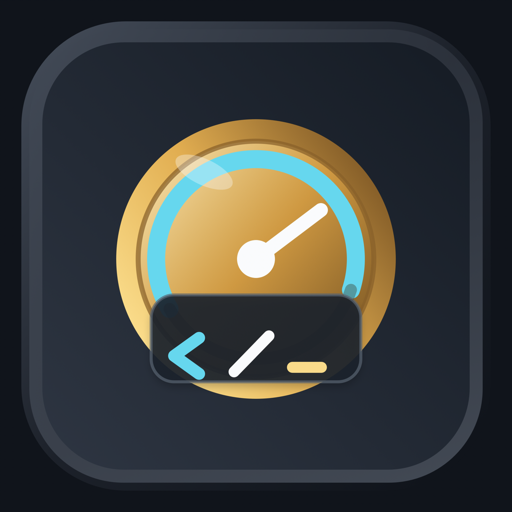
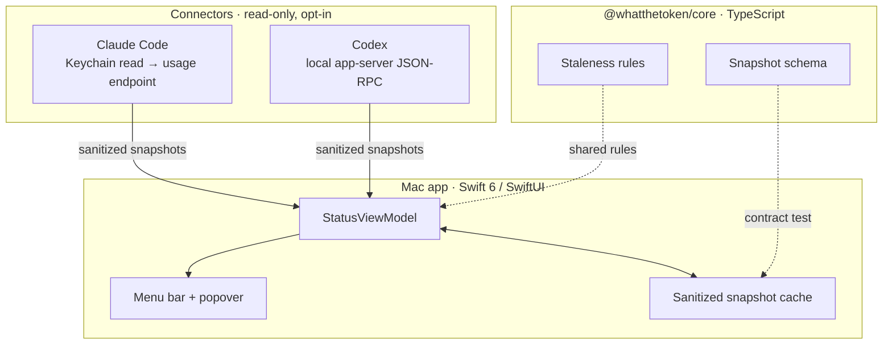

<div align="center">



# WhatTheToken

**Know which AI coding tool you can still use — before it cuts you off.**

A local-first macOS menu bar app that shows your Claude Code and Codex usage limits
in one place, and is honest about how much it actually knows.

[](https://github.com/hansDraisma/whatthetoken-releases/releases/latest)
[](LICENSE)
[](#install)
[](apps/mac)

</div>

---

## The problem

You are forty minutes into a refactor. Claude Code stops and tells you the five-hour
window is gone. You had no warning, because the only place that number lives is inside
the tool that just stopped talking to you.

So you switch to Codex. Is there room there? No idea — that is a different tool, with a
different window, in a different place. You find out by hitting the wall a second time.

Paying for several AI subscriptions means juggling several invisible budgets. There is no
one place to look.

## What it does

WhatTheToken sits in your menu bar and answers three questions:

- **Which tool can I use right now?**
- **When does the constrained window reset?**
- **How much should I trust this number?**

That third question is the one most tools skip.

A 320-point popover hangs off the menu bar icon, one tab per provider. Each row is a quota
pool: what's left, when it resets, how confident the number is, and a colour that changes
as you approach the wall. No Dock icon, no window to manage.

## Why this is harder than it looks

There is no standard for this. Providers expose wildly different amounts of truth about
your own quota, and one of them exposes none at all:

| Provider | What is actually available | What we can honestly claim |
|---|---|---|
| **Claude Code** | An OAuth usage endpoint — undocumented, but used by Anthropic's own client, so stable in practice. Returns real window utilisation and reset times. | `verified` — real numbers |
| **Codex** | No public quota API. But the local Codex app-server answers `account/rateLimits/read`, so the number comes from the tool itself. | `observed` — from the local client |
| **ChatGPT / Gemini** | No quota API of any kind. Limits are dynamic and shift with system load. | Nothing. So they are not supported. |

The tempting move is to model the last row anyway, guess, and render it in the same
confident font as the rest. That is how usage trackers end up lying to you politely.

WhatTheToken makes the opposite trade: **fewer providers, and every number labelled.**

## The confidence model

Every value carries provenance, shown next to the number rather than buried in docs:

| Label | Meaning |
|---|---|
| `verified` | Authoritative provider or local quota data |
| `observed` | Directly counted from a local client |
| `estimated` | Inferred from observed activity and public limits |
| `stale` | The last signal is too old to trust |

Freshness is re-evaluated on load, not frozen at write time — so a snapshot that was
accurate an hour ago is *shown as stale*, not shown as fact. Rows can also carry an
undercount warning when the reading may be low.

The reasoning is in [ADR 0002](docs/adr/0002-confidence-labels-and-provenance.md).

## Privacy, by construction

The interesting privacy question is not "do you promise?" — it is "what would I have to
trust you about?" The answer here is: as little as possible.

**There is no account.** Released builds remain local-only by default. An opt-in sync
configuration can mirror only the sanitized snapshot cache through the WhatTheToken API
to Neon; provider credentials and raw provider responses never enter that path. Without
the sync environment variables, the app talks only to providers you explicitly connect
and the update feed when you click `Check for Updates`. No analytics and no crash
reporting: the error-reporting seam ships with an empty DSN, which the app treats as
"off", so the SDK never starts.

**Credentials are read-only, and never redeemed.** For Claude Code the app reads the
local Keychain item after you consent, uses the access token in memory to ask for usage
status, and discards it. It never writes a provider credential, never mints one, and
never redeems a refresh token — because OAuth refresh rotation is usually single-use, so
redeeming it could invalidate Claude Code's own copy and sign you out. That restraint is
written down in [ADR 0003](docs/adr/0003-never-refresh-provider-tokens.md).

For Codex, no credential is read at all. Authentication stays inside Codex; the app talks
to the local app-server and decodes only rate-limit metadata.

**The deny list is explicit.** Prompts, completions, conversation content, cookies, auth
headers, bearer tokens, session tokens, API keys, and raw provider payloads must never be
collected, persisted, logged, *or used in a test fixture*. That last one matters — it is
where this kind of promise usually leaks.

Connectors start disconnected. Background refresh is off until you turn it on.
Disconnecting deletes that provider's cached data, and if any part of that deletion fails
the app keeps saying "connected" rather than claiming a cleanup it did not finish.

Full boundary: [privacy-boundaries.md](docs/architecture/privacy-boundaries.md).
And since the source is here, none of the above has to be taken on faith.

## Architecture



Two things worth pointing out:

**The snapshot shape is a contract, not a convention.** The schema lives in TypeScript,
and a test in the TS package reaches across into the Swift app's bundled fixture and
validates the raw JSON against that schema — so a mapper change that breaks the shape
fails a test in the other language.

The released app still ends at your menu bar by default. Development builds can opt into
the Neon snapshot-sync path described below.

- Data contract: [`docs/architecture/data-contract.md`](docs/architecture/data-contract.md)
- Stack and approach: [`docs/architecture/tech-stack-and-development-approach.md`](docs/architecture/tech-stack-and-development-approach.md)

## Install

Download the newest signed and notarised DMG from
[Releases](https://github.com/hansDraisma/whatthetoken-releases/releases/latest).

```bash
# optional, recommended: verify the download
shasum -a 256 -c WhatTheToken-<version>.dmg.sha256
```

Open the DMG, drag **WhatTheToken** to Applications, and launch it.
macOS may show a Gatekeeper confirmation on first launch — choose Open. The app then
appears in the menu bar with no Dock icon.

Requires **macOS 14 or later**. Both connectors start disconnected; connect them from the
Connectors pane when you are ready.

### Updates

Updates are manual-first. Sparkle is wired for an explicit `Check for Updates` action in
builds that embed the public appcast URL and EdDSA public key.
Automatic background checks and silent installs remain disabled, so the app never contacts
the update feed unless you ask it to.

GitHub Releases is always a supported path for fetching the newest signed and notarised DMG
yourself.

## What it does not do

Being clear about the edges:

- **No ChatGPT or Gemini quota.** No API exists. Guessing would defeat the point.
- **No API spend tracking.** This is about subscription quotas, not billing dashboards.
- **No iOS, web, or browser surface.** macOS menu bar only.
- **No automatic updates.** Checking for one is something you do, not something that
  happens to you. See [Updates](#updates).
- **Codex numbers are `observed`, not `verified`,** until the app-server quota semantics
  are fully validated.

## Status

Active development ahead of Public V1. Current release is **0.1.5** — a signed and
notarised free DMG with Claude Code and Codex support. Expect rough edges.

Roadmap: [`docs/roadmap/development-roadmap.md`](docs/roadmap/development-roadmap.md).

## Development

```bash
pnpm install --frozen-lockfile

# TypeScript core
pnpm --filter @whatthetoken/core test

# Mac app
cd apps/mac && swift test

# build a runnable .app
apps/mac/Scripts/package-app.sh
```

### Local Neon sync

The sync API keeps the Neon owner credential out of the macOS process. It accepts only
the validated `SnapshotCache` contract and hashes the per-install sync token before using
it as a database key.

```bash
# DATABASE_URL must target the dedicated `whatthetoken` Neon database
DATABASE_URL='postgresql://…/whatthetoken?sslmode=require' pnpm --filter @whatthetoken/api migrate
DATABASE_URL='postgresql://…/whatthetoken?sslmode=require' pnpm --filter @whatthetoken/api dev

cd apps/mac
WTT_SYNC_BASE_URL='http://127.0.0.1:4318' \
WTT_SYNC_TOKEN='use-a-random-value-of-at-least-32-characters' \
swift run WhatTheTokenMac
```

Prerequisites: macOS 14+, Swift 6 toolchain, Node, pnpm 10.

CI runs on synthetic fixtures only. It needs no provider credentials, no Keychain access,
and makes no provider network calls — and neither should any test you write.

## Contributing

Contributions are welcome. [CONTRIBUTING.md](CONTRIBUTING.md) has the setup, the
invariants, and an honest map of what adding a new provider connector actually involves —
including the places where the code currently assumes exactly two providers and would
need generalising first. If you want a way in, those are good places to start.

The one rule that is not negotiable: **never add prompts, responses, credentials, tokens,
cookies, or raw provider payloads to code, tests, fixtures, logs, or issues.** Anything
that weakens the deny list in
[privacy-boundaries.md](docs/architecture/privacy-boundaries.md) needs an ADR first.

Architecture decisions worth reading before proposing changes:

- [ADR 0001 — Local-first, minimal data ingestion](docs/adr/0001-local-first-minimal-data-ingestion.md)
- [ADR 0002 — Confidence labels and provenance](docs/adr/0002-confidence-labels-and-provenance.md)
- [ADR 0003 — Never refresh provider tokens](docs/adr/0003-never-refresh-provider-tokens.md)

## License

Apache-2.0. Copyright 2026 Hans Draisma unless otherwise noted. See [LICENSE](LICENSE)
and [NOTICE](NOTICE); bundled third-party components are attributed in
[THIRD_PARTY_NOTICES.md](THIRD_PARTY_NOTICES.md).

## Trademarks

WhatTheToken is an independent community project, not affiliated with, endorsed by, or
sponsored by Anthropic or OpenAI. "Claude", "Claude Code", and "Anthropic" are trademarks
of Anthropic, PBC; "Codex", "ChatGPT", and "OpenAI" are trademarks of OpenAI, Inc. All
product names are the property of their respective owners and are used only for
identification. See [NOTICE](NOTICE).
